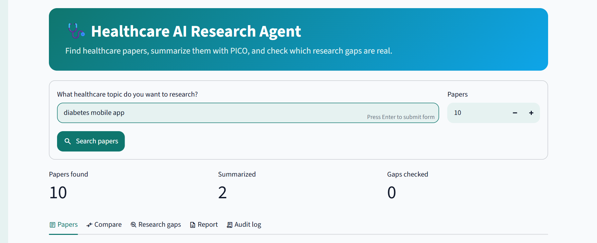
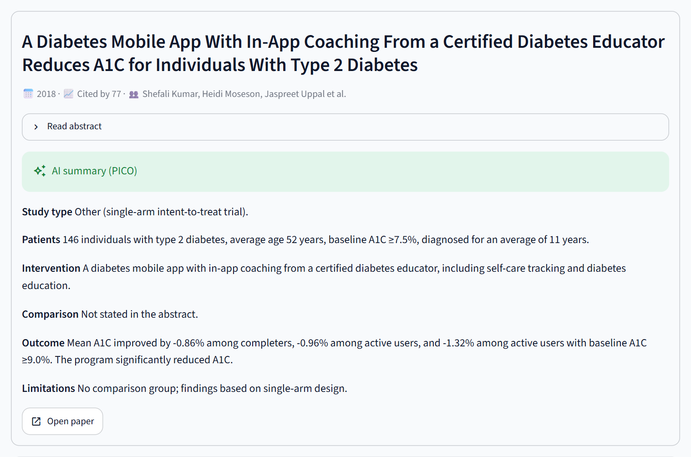
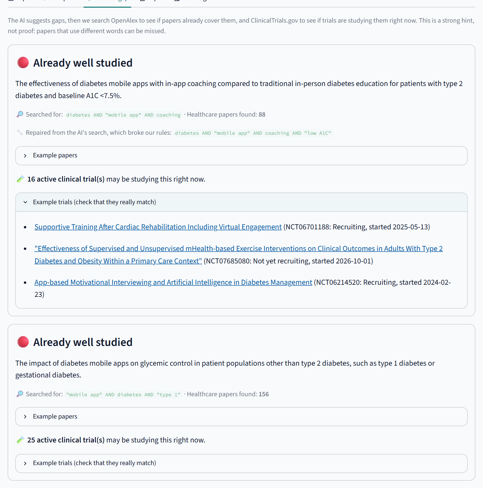
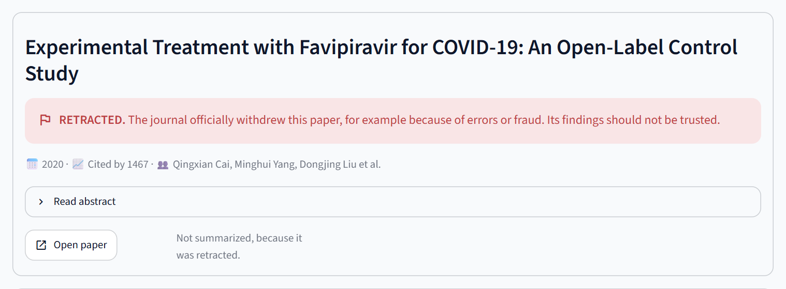
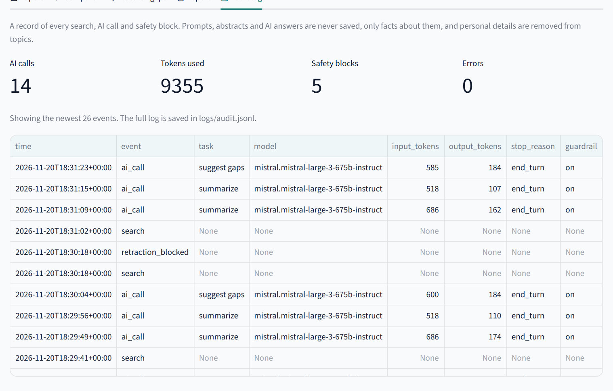

# 🩺 Healthcare AI Research Agent

An AI research assistant for healthcare. It finds real medical papers, summarizes them
in the **PICO** format that medical researchers use, compares them, suggests research gaps,
and then **checks each gap against real research** before trusting it.

Built with **Python**, **Streamlit**, **Amazon Bedrock** (Converse API and Guardrails) and the **OpenAlex** API.



---

## 📸 Screenshots

**PICO summary of a real paper**, grounded in the abstract only:



**Research gaps checked against real data**: the verdict comes from counting published papers in OpenAlex,
🧪 shows active trials from ClinicalTrials.gov, and 🔧 shows when the AI's search was repaired by code:



**Retraction alarm**: this withdrawn COVID-19 study shows up in a normal search and has been cited
over 1,400 times. The agent flags it and refuses to summarize it:



**Audit log**: every AI call, its tokens and stop reason, the guardrail status and every safety block:



---

## ✨ What makes it different

Most AI research tools simply trust the AI, and trust every paper they find.
This one **checks the AI's claims with real data**, **flags withdrawn research**, and wraps every
AI call in a **safety and governance layer**.

| Feature | What it does |
|---|---|
| 🏥 **Healthcare only** | Searches only health fields (Medicine, Nursing, Pharmacology, Dentistry, Health Professions) and only papers with an abstract |
| 📋 **PICO summaries** | Study type, **P**atients, **I**ntervention, **C**omparison, **O**utcome and Limitations, grounded in the abstract only |
| ⚖️ **Comparison** | Common findings, differences and research gaps, with paper numbers like [1] so every claim can be traced |
| 🔎 **Gap checker** | The AI suggests gaps **and** a search for each one. The app counts matching papers in OpenAlex and labels each gap: 🟢 likely a real gap · 🟡 partly studied · 🔴 already well studied |
| 🧪 **Clinical trials check** | For each gap, it also searches **ClinicalTrials.gov** for **active trials**, so you know if someone is studying it right now |
| 🔧 **Search repair** | The AI's searches are checked and repaired **in code** (no OR/NOT, no vague words, max 3 concepts), and the app shows what was changed |
| 📄 **Report with real references** | One downloadable report. References come from OpenAlex, **never from the AI**, so they can't be invented |
| 🚩 **Retraction alarm** | Flags papers that journals have **withdrawn** (for errors or fraud) and refuses to summarize them. OpenAlex lists almost 17,000 retracted healthcare papers |
| 🛡️ **Safety & governance layer** | PII protection, prompt-injection scanner, **Amazon Bedrock Guardrails** and a full audit log (see below) |

---

## 🛡️ Safety & governance layer

Several independent walls ("defence in depth"), so if one misses something, the next one catches it.
The full explanation, with the principles behind each control and how they are tested, is in
**[AI_GOVERNANCE.md](AI_GOVERNANCE.md)**.

📋 A formal **[AI Governance Assessment](docs/GOVERNANCE_ASSESSMENT.md)** ([PDF](docs/GOVERNANCE_ASSESSMENT.pdf)) covers
the system's EU AI Act risk category, a risk register, the controls I would add next, and a test plan.

| Wall | What it does | Where |
|---|---|---|
| 🔐 **PII protection** | Blocks emails, phone numbers, dates of birth, ID numbers and titled names in the search box **before anything leaves the computer** | `src/pii.py` |
| 🚨 **Prompt-injection scanner** | Papers whose text tries to give the AI orders ("ignore all previous instructions…", hidden invisible characters, fake `</paper>` tags) are never sent to the AI | `src/injection.py` |
| 🧱 **Grounded, delimited prompts** | Paper text sits inside `<paper>` tags with an instruction not to follow anything inside | `src/prompts.py` |
| ☁️ **Amazon Bedrock Guardrails** | AWS's AI-based filters on every call: prompt-attack detection, harmful content, a denied topic (**personal medical advice**), and masking of personal details in answers | `scripts/create_guardrail.py`, `src/bedrock_client.py` |
| 🚩 **Retraction alarm** | Withdrawn papers are flagged and never summarized | `src/openalex_client.py` |
| 🧾 **Audit log** | Every search, AI call (tokens, time, stop reason) and safety block is recorded. Prompts and answers are never stored (data minimisation) | `src/audit_log.py` |

**A real engineering lesson:** applied to the whole prompt, Bedrock Guardrails flagged **17 of 27** real
medical abstracts (on suicide prevention, domestic violence, HIV and more) as prompt attacks, because it read
the app's own instructions as an attack. Using **input tagging** (`guardContent`), so only the untrusted paper text is checked,
brought false alarms to **0 of 27**, while still blocking every test attack, including one the regex scanner missed.

---

## 🧠 How it works

```
            ┌──► OpenAlex 📚            find papers, count papers for each gap   (free)
  app.py  ──┼──► ClinicalTrials.gov 🧪  active trials for each gap               (free)
(Streamlit) └──► Amazon Bedrock 🧠      summarize, compare, suggest gaps         (pay per use)
```

1. **Search**: OpenAlex returns healthcare papers on your topic.
2. **Summarize** (on click): Bedrock writes a PICO summary from the abstract.
3. **Compare**: Bedrock compares the summarized papers.
4. **Check gaps**: Bedrock suggests 3 gaps with search queries. The app repairs each query,
   counts papers in titles and abstracts, gives a verdict, and looks for active clinical trials.
5. **Report**: Python puts everything together with a reference list. No AI, so it's free.

The full study guide, with every file explained, is in [docs/HOW_IT_WORKS.md](docs/HOW_IT_WORKS.md).
How AI governance is built into the code is explained in [AI_GOVERNANCE.md](AI_GOVERNANCE.md).

---

## 🛠️ Tech stack

| Part | Tool |
|---|---|
| Web interface | Streamlit |
| AI model | Mistral Large 3 on **Amazon Bedrock**, through the **Converse API** (boto3) |
| Research data | **OpenAlex** API (250+ million papers) and **ClinicalTrials.gov** API v2 |
| AI safety | **Amazon Bedrock Guardrails** (with input tagging), plus our own PII and injection checks |
| Testing | **pytest** (61 tests, with mocking) |
| Language | Python (dataclasses, type hints, regex) |

---

## ✅ Quality and cost

- **Grounded prompts:** the AI may only use the title and abstract, and writes
  "Not stated in the abstract." instead of guessing.
- **Validated output:** every AI answer is checked (headings or JSON) and retried once if it's incomplete.
- **Rules checked in code, not only in prompts:** the AI sometimes ignored the prompt's search rules
  (4 concepts, OR, long quoted phrases), which found 0 papers and made every gap look "real".
  `clean_search` repairs each query, which took real examples from 0 to 6 and 16 matching papers.
  Names with numbers like "type 1 diabetes" stay exact, so they don't match type 2 papers.
- **Automated tests:** 61 pytest tests, including attacks that must be caught, real medical
  sentences that must **not** be blocked, and "what if ClinicalTrials.gov is down?" (mocked).
  They never call AWS or other websites, so they're free to run.
- **Real references only:** reference lists are built from OpenAlex data, not written by the AI.
- **Cost control:** the AI runs only when you click, summaries are cached so the same paper is never paid for twice,
  answers have a token limit, and comparisons use short summaries instead of full abstracts.
- **Secrets stay out of the code:** AWS keys live in `~/.aws`, and settings live in `.env` (never uploaded).

> ⚠️ This is a tool for studying research, **not medical advice**. AI summaries can contain
> mistakes, so always check the original paper.

---

## 🚀 Setup (Windows)

**You need:** Python 3.12 or newer, an AWS account with Amazon Bedrock access, and a free
[OpenAlex API key](https://openalex.org/settings/api-key).

1. Create a virtual environment and install the packages:

   ```
   python -m venv .venv
   .venv\Scripts\Activate.ps1
   pip install -r requirements.txt
   ```

2. Create your settings file, then add your OpenAlex key to it:

   ```
   copy .env.example .env
   ```

3. In the AWS Console, open **Amazon Bedrock** and make sure the model in `.env` is available
   in your region. Create an IAM user that is allowed to call Bedrock, then save its access key
   on your computer (never in this project):

   ```
   aws configure
   ```

4. *(Optional)* Create the safety guardrail in your AWS account, then put the two printed
   values in `.env`. Without them, the app simply runs without the guardrail:

   ```
   python scripts/create_guardrail.py
   ```

5. Start the app (or double-click `start_app.bat`):

   ```
   streamlit run app.py
   ```

6. Run the tests (free, no AWS calls):

   ```
   python -m pytest
   ```

---

## 📁 Project structure

```
app.py                  The web page (Streamlit)
config/settings.py      Reads settings from .env
src/models.py           The Paper data class
src/openalex_client.py  Searches and counts healthcare papers in OpenAlex (and reads retractions)
src/bedrock_client.py   The only file that talks to the AI: Converse API, guardrail, audit logging
src/trials_client.py    Finds active clinical trials on ClinicalTrials.gov
src/pii.py              Finds and removes personal details
src/injection.py        Finds prompt-injection attacks in paper text
src/audit_log.py        Records every search, AI call and safety block
src/prompts.py          All the instructions given to the AI
src/summarizer.py       PICO summary of one paper
src/analyzer.py         Compares papers
src/gap_checker.py      Suggests gaps with AI, repairs the searches, checks papers and trials
src/report.py           Builds the downloadable report with references
scripts/create_guardrail.py  Creates the Bedrock Guardrail (infrastructure as code)
tests/                  Automated tests (pytest)
.streamlit/config.toml  The app's colours and theme
docs/HOW_IT_WORKS.md    Full study guide
AI_GOVERNANCE.md        How privacy, security, safety and accountability are built in
docs/GOVERNANCE_ASSESSMENT.md  EU AI Act classification, risk register, controls to add, test plan
```

---

## ✅ Progress

- [x] Search healthcare papers with OpenAlex
- [x] Connect to Amazon Bedrock
- [x] PICO summaries
- [x] Compare papers
- [x] Gap checker verified against OpenAlex
- [x] Research report with real references
- [x] Modern interface (theme, tabs, cards)
- [x] PII protection
- [x] Audit log
- [x] Prompt-injection scanner
- [x] Retraction alarm
- [x] Amazon Bedrock Guardrails
- [x] Clinical trials check (ClinicalTrials.gov)
- [x] Search repair in code
- [x] Automated tests (61)
- [ ] Real agent with tool use (the AI decides when to search)
- [ ] Deploy online

---

## ⚖️ Known limitations

- Summaries use the **abstract only**, not the full paper.
- Gap counts are a **strong hint, not proof**: papers that use different words can be missed,
  and the 🟢/🟡/🔴 thresholds (10 and 50 papers) are a first estimate.
- It's an **AI pipeline with one agent-like step** (the AI writes its own searches), not yet a full agent.
- The PII and injection checks use **patterns (regex)**: a name without a title ("John Smith") or a cleverly
  reworded attack can slip past them. That's why Bedrock Guardrails sits behind them as another wall.
- It's built for **one user**. To scale, AI calls would run in parallel with retries, summaries would be cached in
  DynamoDB by paper ID, the audit log would move to CloudWatch, and the app would run in containers on ECS Fargate.
